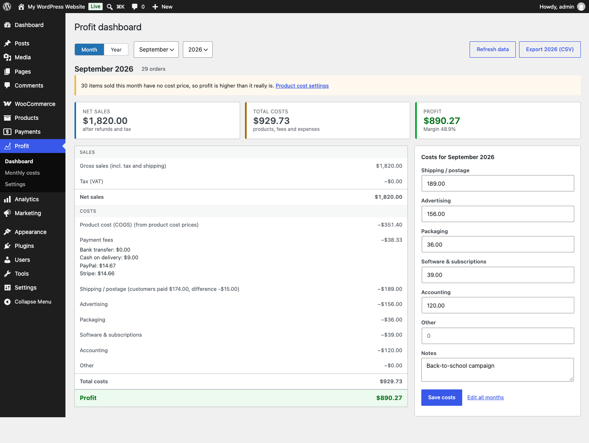
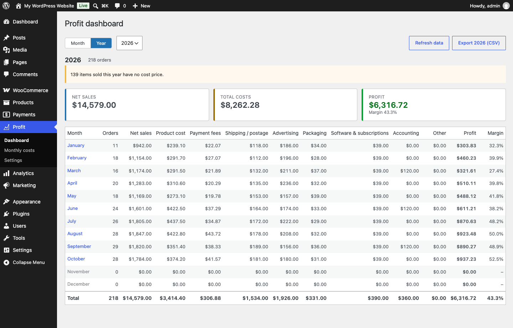
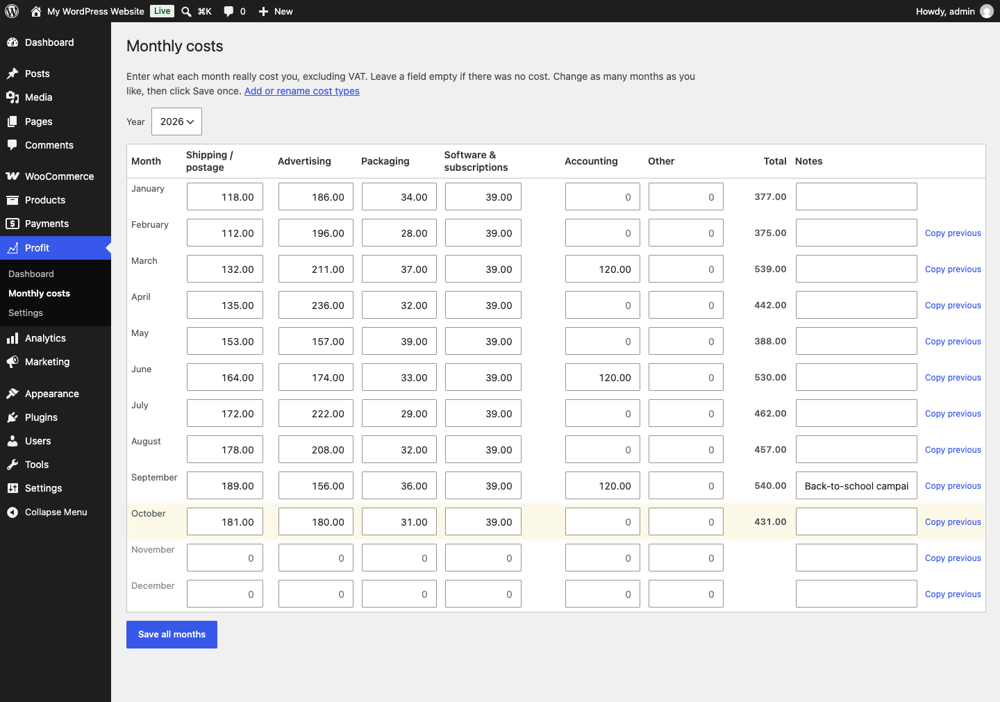
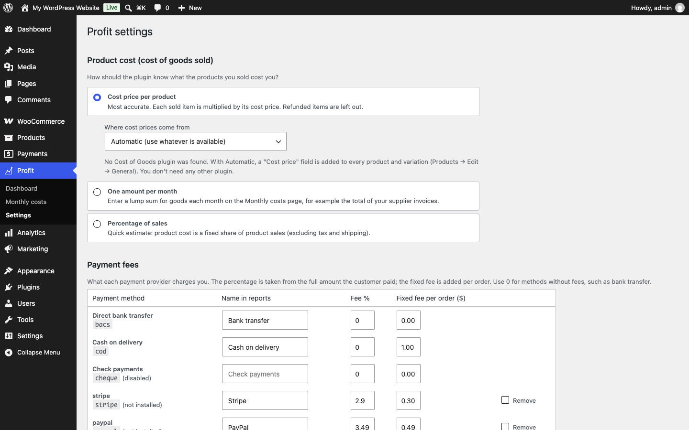
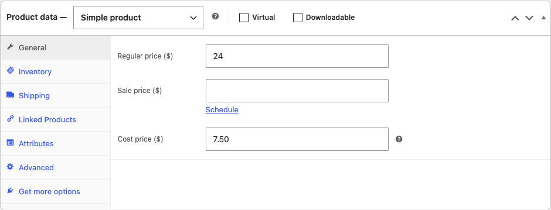

# Simple Profit Calculator for WooCommerce

See your **real** monthly and yearly profit in WooCommerce: sales minus refunds and tax, minus product costs, payment fees and your own monthly expenses.

[](https://github.com/ahmadscience/simple-profit-calculator-for-woocommerce/actions/workflows/ci.yml)
[](https://github.com/ahmadscience/simple-profit-calculator-for-woocommerce/releases/latest)




## Features

- **Product cost (COGS)**, whichever way suits your store:
  - WooCommerce's built-in Cost of Goods, or the Cost of Goods plugins by WPFactory or SkyVerge (detected automatically),
  - a **Cost price** field this plugin adds to products and variations when no cost plugin is installed,
  - one lump sum per month (e.g. your supplier invoices), or
  - a percentage of sales.
- **Payment fees** per payment method: percentage and/or fixed fee per order.
- **Your own monthly costs** (shipping, ads, packaging, software, rent…): edit a whole year on one screen and save once.
- Monthly breakdown, yearly overview, **CSV export**, warnings for products without a cost price.
- Partial refunds handled. HPOS and legacy order storage. Uses your store's currency, timezone and number format.
- **Private by design:** no external requests, no tracking, no customer data stored.

| Yearly overview | Monthly costs |
|---|---|
|  |  |
| **Settings** | **Cost price on products** |
|  |  |

## Install

- **WordPress.org:** *Plugins → Add New*, search for "Simple Profit Calculator for WooCommerce" (once approved).
- **From GitHub:** download `simple-profit-calculator-for-woocommerce.zip` from the [latest release](https://github.com/ahmadscience/simple-profit-calculator-for-woocommerce/releases/latest), then *Plugins → Add New → Upload Plugin*.

Requires WordPress 6.3+, WooCommerce 7.0+, PHP 7.4+. Then follow the [5-minute setup](docs/user-guide.md#2-set-up-5-minutes).

## Documentation

| | |
|---|---|
| 📘 [User guide](docs/user-guide.md) | Setup, every screen, how each number is calculated, troubleshooting |
| 🛠 [Developer guide](docs/developer.md) | Architecture, data model, filters with examples, caching, testing, releasing |
| 🔒 [Security model & audit](docs/security.md) | What the plugin can access, controls, audit findings, how releases are verified |
| 📝 [Changelog](CHANGELOG.md) | What changed in each version |

## Support

- 🐞 **Bugs:** [open a bug report](https://github.com/ahmadscience/simple-profit-calculator-for-woocommerce/issues/new?template=bug_report.yml)
- 💡 **Feature requests:** [suggest a feature](https://github.com/ahmadscience/simple-profit-calculator-for-woocommerce/issues/new?template=feature_request.yml)
- 💬 **Questions:** [Discussions](https://github.com/ahmadscience/simple-profit-calculator-for-woocommerce/discussions)
- 🔒 **Security issues:** report **privately**, see [SECURITY.md](SECURITY.md)

## Security

Every push is checked by CI: WordPress Coding Standards (including the escaping, sanitising, nonce and SQL sniffs), PHP 7.4+ compatibility, the official [WordPress Plugin Check](https://github.com/WordPress/plugin-check-action), and an integration test suite in real WordPress + WooCommerce with dedicated security tests. See [docs/security.md](docs/security.md).

## Development

```bash
# Static checks
phpcs --standard=WordPress --extensions=php --ignore=tests .
phpcs --standard=PHPCompatibilityWP --runtime-set testVersion 7.4- --extensions=php .

# Integration tests in WordPress Playground (needs Node.js)
npx @wp-playground/cli@3.1.55 run-blueprint --blueprint=tests/blueprint.json \
  --mount=.:/wordpress/wp-content/plugins/simple-profit-calculator-for-woocommerce --mount=./tests:/tests

# Build the installable zip (leaves out everything in .distignore)
bin/build-zip.sh
```

See [CONTRIBUTING.md](CONTRIBUTING.md) and the [developer guide](docs/developer.md).

## License

GPLv2 or later. See [LICENSE](LICENSE).

Made by [Ahmad Abdur Rehman](https://ahmad.science).
